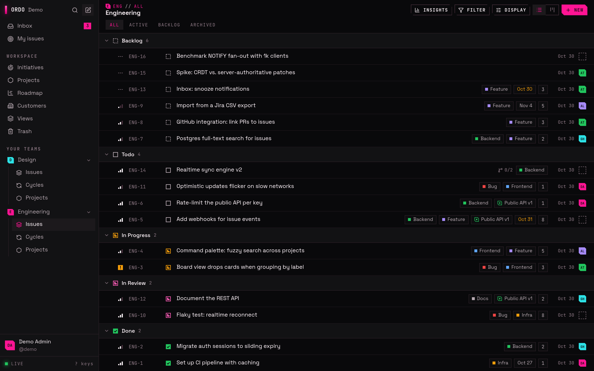
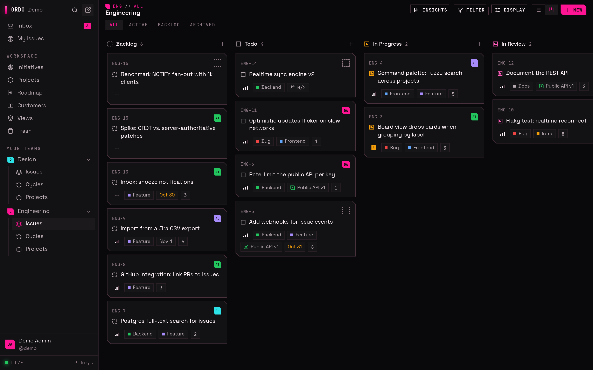
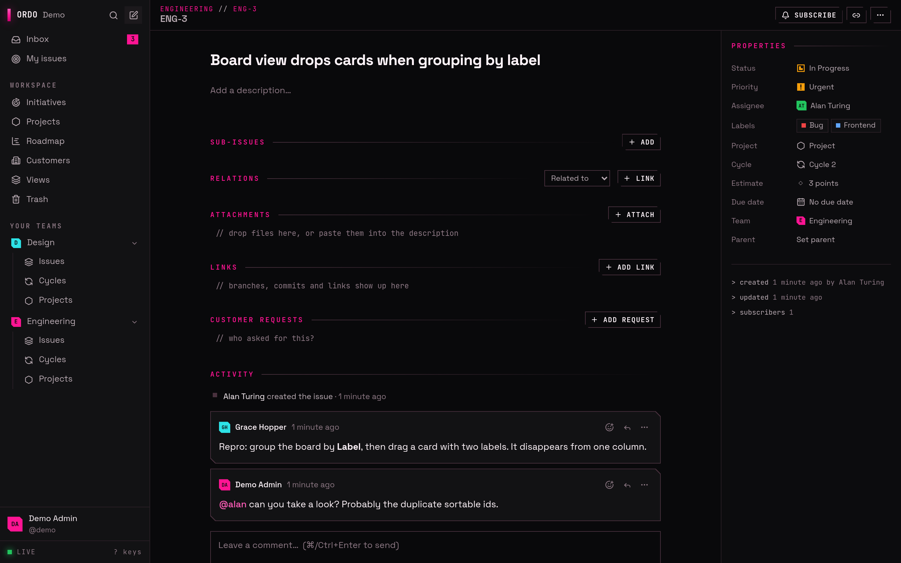
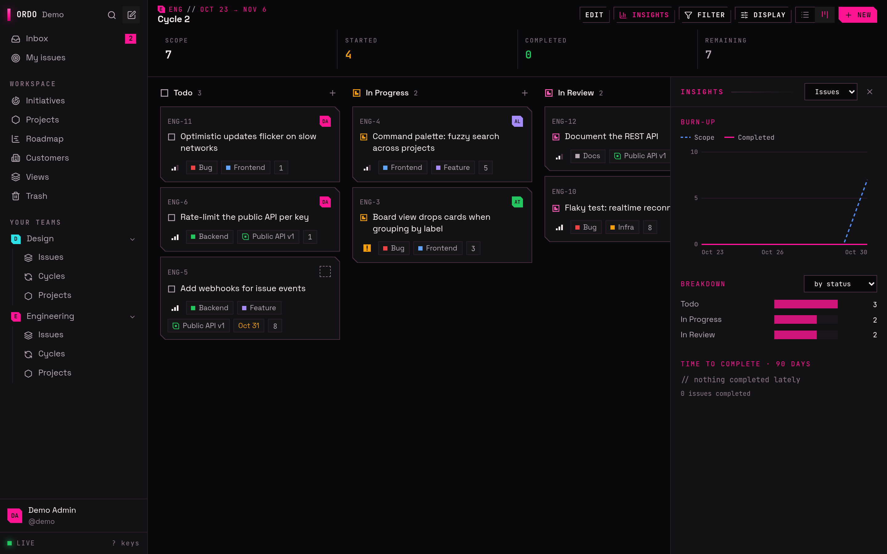
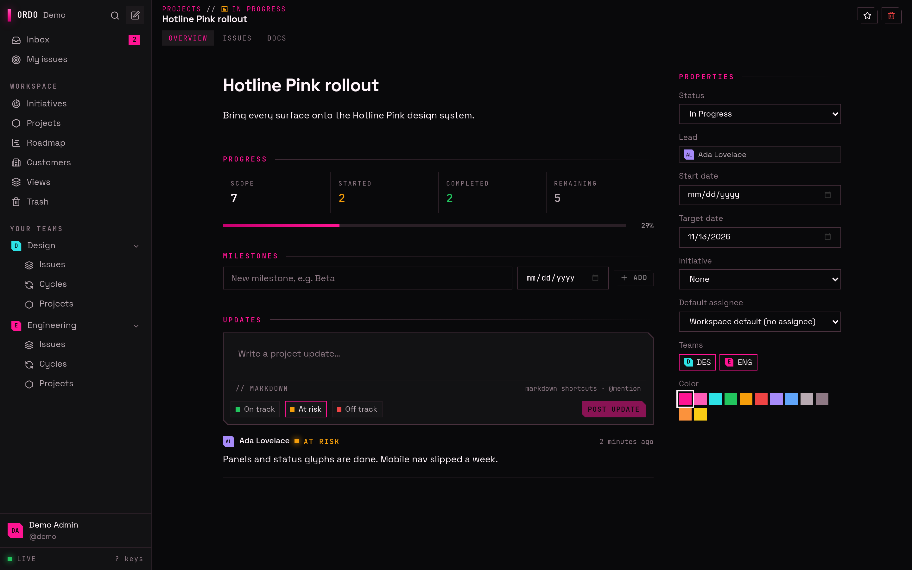
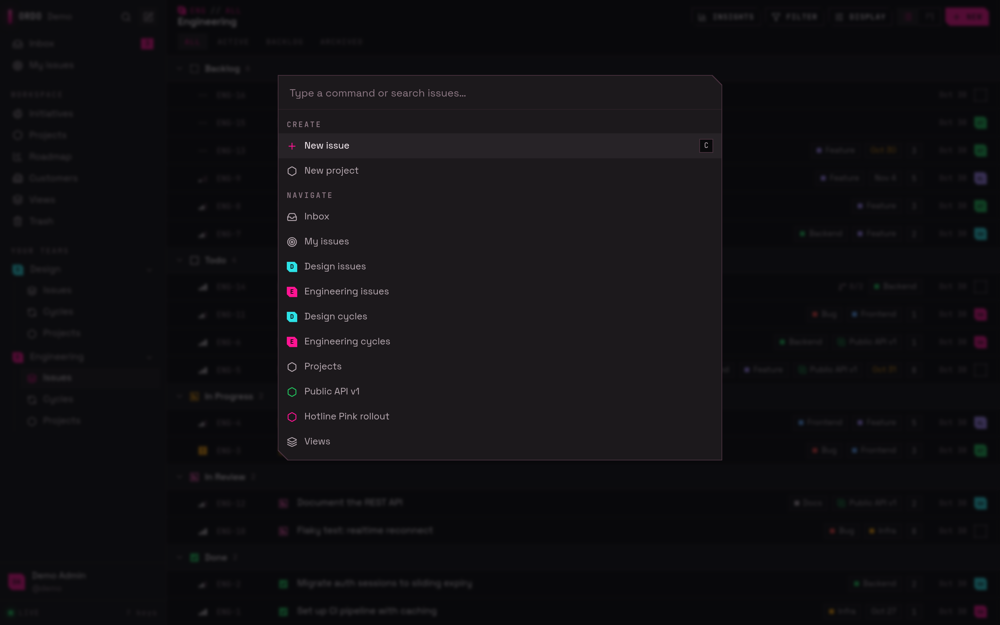
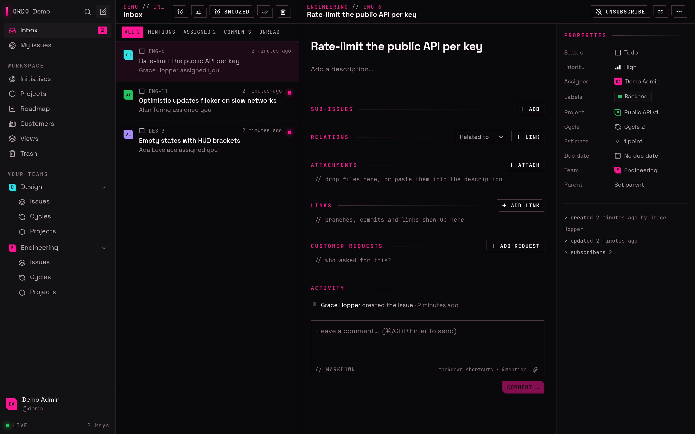

<div align="center">

# Ordo

**The issue tracker you run yourself.**

Keyboard-first, realtime and opinionated about workflow: issues, cycles, projects and an inbox that keeps up with
your team, on your own server, with one command.

[Quick start](#quick-start) · [Features](#features) · [Documentation](docs/README.md) · [Roadmap](ROADMAP.md) ·
[License](#license)



</div>

## Quick start

You need Docker with Compose v2 and `make`.

```bash
git clone https://github.com/imevul/ordo.git && cd ordo
make up
```

`make up` writes a `.env` with fresh secrets, builds the image, starts Ordo and Postgres, and waits until they're
healthy. Open <http://localhost:3000> and sign up: the first account becomes the instance admin.

Want something to click around in first? `make seed` adds a demo workspace (`demo@ordo.test` /
`ordo-demo-password`).

Before you put it on the internet, set `ORDO_PUBLIC_URL` and serve it over HTTPS. The
[self-hosting guide](docs/self-hosting.md) has Caddy and nginx examples, plus backups, upgrades, monitoring and
running without Docker.

| Command               | What it does                                      |
| --------------------- | ------------------------------------------------- |
| `make up` / `down`    | Start or stop Ordo (data stays in Docker volumes) |
| `make update`         | Pull, rebuild and restart; migrations run on boot |
| `make backup`         | Dump the database and uploads to `backups/`       |
| `make restore FILE=…` | Restore a backup                                  |
| `make logs`           | Follow the application logs                       |
| `make help`           | Everything else                                   |

One container serves the API and the web app; the only other service is Postgres.

## Features

### Plan and track

Issues get a team identifier (`ENG-42`), a status from the team's own workflow, a priority, assignee, labels,
estimate, due date, sub-issues and relations. Descriptions and comments use a rich text editor that stores
Markdown, with threads, `@mentions`, reactions and attachments. Every change is kept in the issue's history.

Look at your work as a **list or a board**, grouped and ordered the way you like, with filters, multi-select, bulk
edits and drag-and-drop. Save the views you use, share them with the workspace or keep them private.





### Cycles, projects and roadmaps

**Cycles** are time-boxed iterations per team, with scope, progress, burn-up charts and automation that rolls
unfinished work over. **Projects** span teams, with a lead, dates, milestones, health, written updates and
documents. Group projects into **initiatives** and see them all on a **roadmap** timeline.





### Fast, for people who live in it

Press `⌘K` / `Ctrl K` for the command menu and `?` for the shortcuts: almost everything has one. Changes show up for
everyone instantly. Browsers keep a local copy of the workspace, so it opens at once, stays readable offline and
sends what you changed when you're back. Install it as an app on desktop or phone, with push notifications, in a
dark or light theme, in English, Swedish or Norwegian.



### An inbox that respects your attention

Assignments, mentions, comments and status changes on the issues you follow land in one inbox. Choose per kind of
notification whether it goes to the inbox, push, email or chat; snooze, filter, or pause everything but mentions.



### Connected to your tools

- **Git forges**: GitHub, GitLab and Forgejo/Gitea link branches, commits and pull requests to issues and move
  issues along as they progress. Polling works for instances the forge can't reach.
- **Chat**: Slack, Discord, Matrix and Telegram get channel feeds, personal notifications, issues from messages and
  threaded comment sync.
- **Email** to an address becomes triage issues; **Jira** can be linked, mirrored or synced both ways.
- **Imports** from CSV, GitHub Issues, GitLab, Forgejo/Gitea, Jira and other trackers, with mapping, dry runs and
  undo. **Export** the whole workspace as JSON, or issues as CSV.

### Built for agents too

Assign an issue to an **agent** and a runner you host (Claude Code, OpenCode or your own program) picks it up, works
on it and reports back on the issue. A project's pull request agent reviews what comes in. AI clients connect through
the built-in **MCP server**, and optional AI assistance (the Claude API or a local model) writes summaries, drafts and
triage suggestions.

### Ready for a whole organisation

Workspaces with owners, admins, members and guests, private teams and team admins. Sign in with passwords, passkeys,
TOTP, or **single sign-on** over OpenID Connect or SAML 2.0 per workspace, with group → role mapping and directory
sync over **SCIM 2.0**. An audit log, secrets encrypted at rest, and an instance admin area for users, workspaces,
email, jobs and health.

### Open to build on

**REST and GraphQL APIs** with personal API keys, signed **webhooks** for issues, comments, projects and cycles, a
typed **TypeScript SDK**, and the **`ordo` CLI**, which every instance serves at `/cli/ordo.mjs`.

## Documentation

Everything lives in [docs/](docs/README.md):

- **Using Ordo**: [user guide](docs/user-guide.md), [keyboard shortcuts](docs/keyboard-shortcuts.md),
  [import and export](docs/import-export.md)
- **Running it**: [self-hosting](docs/self-hosting.md), [configuration](docs/configuration.md),
  [administration](docs/admin.md), [SSO](docs/sso.md), [SCIM](docs/scim.md)
- **Integrating**: [REST API and webhooks](docs/api.md), [GraphQL](docs/graphql.md), [CLI and SDK](docs/cli.md),
  [MCP](docs/mcp.md), [agents](docs/agents.md), [integrations](docs/integrations/README.md)
- **Working on it**: [architecture](docs/architecture.md), [development](docs/development.md),
  [design system](docs/design.md)

## Status

Ordo is young (v0.1) but broad: everything above has shipped and is covered by tests. Expect rough edges, and
breaking changes before 1.0. The [roadmap](ROADMAP.md) shows what's next.

## Contributing

Bug reports and ideas are welcome as [GitHub issues](https://github.com/imevul/ordo/issues). To work on the code,
see [CONTRIBUTING.md](CONTRIBUTING.md): it covers the dev setup (`make dev`), the checks a change must pass and the
terms contributions are made under.

## License

Ordo is source-available under the [Functional Source License 1.1, Apache 2.0 Future License](LICENSE.md)
(FSL-1.1-ALv2).

- **You can** self-host it for yourself or your organisation, change it, and contribute back.
- **You can't** offer Ordo, or a substantially similar product, to others as a commercial product or service.
- **Each release becomes Apache 2.0** two years after it is published.

Code up to the tag `apache-2.0-final` was released under the Apache License 2.0 and stays available under it.
